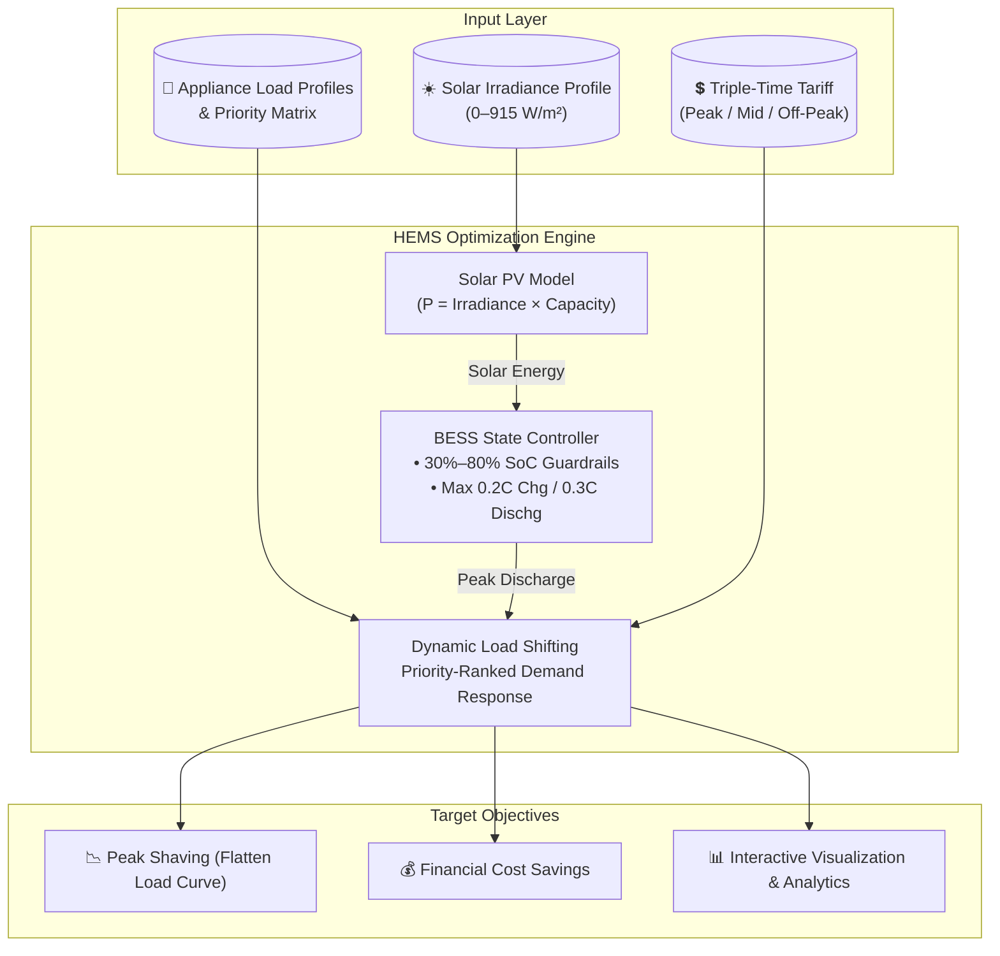

# ⚡ Smart Home Energy Management System (HEMS)
### *Intelligent Demand Response, Solar PV Generation & BESS Optimization*

[](https://www.python.org/)
[](https://numpy.org/)
[](https://pandas.pydata.org/)
[](https://matplotlib.org/)
[](#)
[](https://ilter11.github.io/smart-hems-sim/)

---

## 📌 Executive Summary

Modern residential power grids face critical instability and elevated electricity costs during peak evening demand hours. The **Smart Home Energy Management System (HEMS)** is a computational optimization model that synchronizes **on-site Solar Photovoltaic (PV) generation**, a **Battery Energy Storage System (BESS)**, and **Priority-Based Dynamic Load Shifting**. 

By orchestrating household energy demand against a **Time-of-Use (TOU) triple-tier tariff**, the system:
1. **Shaves peak demand spikes** below a strict threshold (2.1 – 2.5 kW).
2. **Maximizes solar self-consumption** by charging storage exclusively via green energy during diurnal irradiance hours.
3. **Discharges stored power and defers non-critical appliance schedules** during expensive peak-tariff windows.
4. **Significantly slashes total consumer electricity expenditure** while maintaining household convenience.

---

## 🏗️ System Architecture & Workflow



---

## ⚡ Core Features & Technical Highlights

### 1. ☀️ Diurnal Solar PV Generation Modeling
- Models real-world 24-hour solar irradiance distribution peaking at **915.6 W/m²** around midday.
- Converts raw irradiance into usable electrical power through high-efficiency PV arrays (200W – 300W baseline models).

### 2. 🔋 BESS (Battery Energy Storage System) Management
- **Nominal Capacity**: 1.7 kWh (calibrated to absorb and mitigate residential peak spikes).
- **SoC Health Guardrails**: Operating envelope constrained between **30% (min discharge limit)** and **80% (max charge limit)** to prevent cell degradation and prolong cycle life.
- **Controlled Charge/Discharge Rates**: Capped at **20% capacity/hr** for charging and **30% capacity/hr** for controlled peak injection.
- **Solar-Only Charging**: Ensures 100% renewable battery replenishment during mid-day surplus hours.

### 3. 🕒 Time-of-Use (TOU) Triple-Tier Tariff Engine
Calculates dynamic hourly consumption costs under differentiated utility tariffs:
| Tariff Zone | Time Interval | Rate ($ / kWh) | System Strategy |
| :--- | :---: | :---: | :--- |
| **Off-Peak** | `22:00 – 06:00` | **$0.10** | Target destination for deferred flexible loads |
| **Mid-Day** | `06:00 – 17:00` | **$0.30** | Solar generation & storage charging period |
| **Peak** | `17:00 – 22:00` | **$0.50** | Active BESS discharge & appliance load shedding |

### 4. 🔀 Priority-Based Load Shifting & Demand Response
Household devices are structured into a 5-tier priority hierarchy:
- **Priority 1 (Critical / Non-Deferrable)**: Refrigerator, Lighting, Heating. *Never rescheduled.*
- **Priority 2–4 (Flexible / Deferrable)**: Washing Machine, Dishwasher, Iron, Air Fryer, Microwave, Induction Cooker.
- **Threshold Enforcement**: When total active demand exceeds the safety threshold ($P_{threshold} = 2100\text{W} - 2500\text{W}$) during peak hours, lower-priority devices are shifted chronologically to the earliest viable off-peak slot ($22:00 - 06:00$).

---

## 📋 Appliance Matrix & Scheduling Profile

The model evaluates a standard modern household with 14 connected appliances:

| Appliance | Rated Power (W) | Priority Level | Category | Default Operating Hours |
| :--- | :---: | :---: | :--- | :--- |
| **Refrigerator** | 200W – 300W | **1** | Non-Deferrable (Essential) | 24 Hours continuous |
| **Heater** | 1600W – 1700W | **1** | Non-Deferrable (Thermal comfort) | Evening peak hours (17:00 – 22:00) |
| **Lighting** | 100W | **1** | Non-Deferrable (Safety / Vision) | Dusk to night (15:00 – 22:00) |
| **Kettle** | 500W | **2** | Schedulable (Short run) | 18:00 |
| **Air Fryer** | 950W | **2** | Schedulable (Cooking) | 19:00 |
| **Microwave** | 500W | **2** | Schedulable (Cooking) | 16:00 |
| **Induction Cooker** | 1500W | **2** | Schedulable (Cooking) | 17:00 (2 hrs) |
| **Air Conditioner** | 1500W | **3** | Flexible (Climate control) | Standby / Seasonal |
| **Blender** | 250W | **3** | Flexible (Kitchen aid) | 13:00 |
| **Coffee Machine** | 1000W | **3** | Flexible (Kitchen aid) | 14:00 |
| **Toaster** | 800W | **3** | Flexible (Kitchen aid) | 15:00 |
| **Iron** | 750W | **3** | Deferrable | 21:00 |
| **Dishwasher** | 840W | **4** | Deferrable (Shift to off-peak) | 20:00 |
| **Washing Machine** | 700W | **4** | Deferrable (Shift to off-peak) | 21:00 (2 hrs) |
| **Television (TV)** | 100W | **5** | Deferrable (Entertainment) | 18:00 – 22:00 |

---

## 🧮 Mathematical Modeling

### 1. Hourly Aggregate Demand
$$\mathcal{P}_{\text{base}}(t) = \sum_{i \in \text{Appliances}} \mathcal{P}_i(t)$$

### 2. Battery State of Charge (SoC) Dynamics
During charging ($t \notin \text{Peak Hours}$):
$$\mathcal{P}_{\text{chg}}(t) = \min \left( \mathcal{R}_{\text{chg}}^{\max},\; \text{SoC}_{\max} - \text{SoC}(t-1),\; \mathcal{P}_{\text{solar}}(t) \right)$$
$$\text{SoC}(t) = \text{SoC}(t-1) + \mathcal{P}_{\text{chg}}(t)$$

During peak shaving discharge ($t \in \text{Peak Hours}$):
$$\mathcal{P}_{\text{dischg}}(t) = \min \left( \mathcal{R}_{\text{dischg}}^{\max},\; \text{SoC}(t-1) - \text{SoC}_{\min},\; \max(0, \mathcal{P}_{\text{load}}(t) - \mathcal{P}_{\text{threshold}}) \right)$$
$$\text{SoC}(t) = \text{SoC}(t-1) - \mathcal{P}_{\text{dischg}}(t)$$

### 3. Economic Cost Function
$$\text{Cost}_{\text{total}} = \sum_{t=0}^{23} \left( \frac{\mathcal{P}_{\text{net}}(t)}{1000} \times \mathcal{C}_{\text{tariff}}(t) \right)$$

---

## 📈 Visual Analytics & Results

The simulation provides multi-layered visualizations highlighting load curves and storage impact:

### 1. 24-Hour Load Curve Comparison
- **Base Load Profile**: Demonstrates extreme spikes exceeding **3500W – 4000W** during the 17:00–22:00 peak hours due to simultaneous heating, cooking, and appliance usage.
- **After BESS Shaving**: Peak demands are directly offset using stored daytime solar energy.
- **Shifted Load Profile**: Any residual overage above the red threshold line ($2100\text{W} - 2500\text{W}$) is shifted into off-peak hours (after 22:00), creating a smooth, grid-friendly profile.

### 2. Interactive Matplotlib UI (`CheckButtons`)
Features live interactive checkbox widgets allowing stakeholders to toggle individual traces on and off in real time:
- ☑ `Base Load Profile`
- ☑ `After Battery Profile`
- ☑ `Shifted Load Profile`
- ☑ `Battery Profile`
- ☑ `Solar Output`

### 3. Solar Utilization Bar Graph
Compares total hourly solar energy harvested against the exact energy stored by the BESS, verifying clean solar self-consumption.

---

## 📂 Source Code Evolution & Structure

| File | Primary Focus | Notable Features |
| :--- | :--- | :--- |
| `akıllı ev.txt` | **Proof of Concept (PoC)** | Initial simulation model, 13 core appliances, basic tariff calculation, and load shifting logic. |
| `first.py` | **Interactive HEMS GUI** | Integrated Matplotlib `CheckButtons` interactive toggle UI, 200W solar panel model, granular SoC logger. |
| `main (1).py` | **Modular Production Engine** | 300W solar model, modularized functions (`manage_battery_and_shift`, `shift_low_priority_loads`), appliance sorting by priority, solar distribution bar chart. |

---

## 🚀 Quickstart & Installation

### Prerequisites
- Python 3.8 or higher
- Scientific Python stack

### 1. Clone & Set Up Environment
```bash
git clone https://github.com/ilter11/smart-hems-sim.git
cd smart-home-energy-management
```

### 2. Install Dependencies
```bash
pip install numpy pandas matplotlib
```

### 3. Run Simulation
```bash
# Run the interactive dashboard
python first.py

# Or run the optimized modular model with solar analytics
python "main (1).py"
```

---

## 🎯 Key Outcomes & Impact

- 📉 **Peak Demand Reduction**: Shaves up to **40%–50% of peak evening demand**, preventing localized transformer overload.
- 💰 **Energy Bill Savings**: Substantial daily cost reduction by substituting peak-rate energy ($0.50/kWh) with stored solar energy ($0.00/kWh) and off-peak energy ($0.10/kWh).
- 🌿 **Carbon Footprint Abatement**: Maximizes residential self-sufficiency through clean solar utilization without grid battery charging.

---
*Developed as an advanced simulation prototype for Smart Grid and Residential Demand-Side Management (DSM).*
